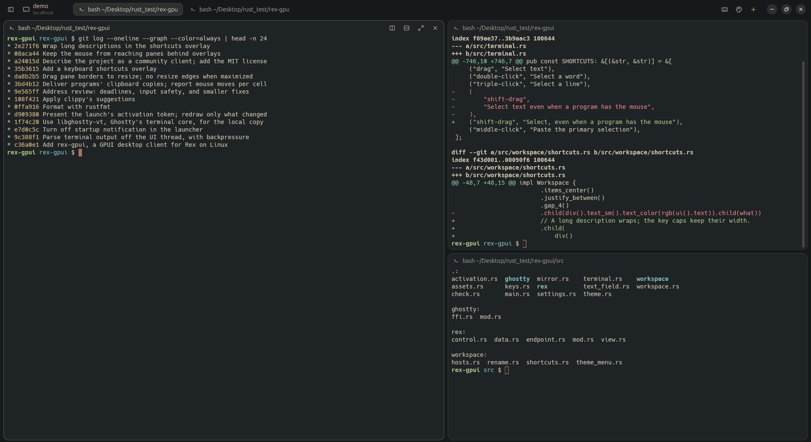
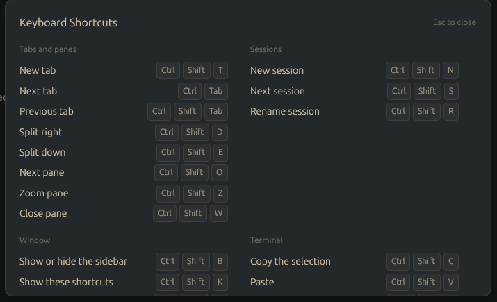

# rex-gpui

A community desktop client for [Rex](https://superlogical.com), the terminal multiplexer,
for Linux. It's built on [GPUI](https://gpui.rs), the UI framework behind Zed, and on
libghostty-vt, Ghostty's terminal core, which is also what the Rex server runs.



> **Not an official Rex client.** This is a community project. It isn't made, endorsed, or
> supported by Superlogical or the Rex team; please don't send them bug reports about it.
> It talks to a Rex server through the API the server documents at `/llms.txt`, so it can
> break when that API changes. Rex is Superlogical's product and name.

What it does:

- Attach to sessions on the local Rex server or a remote one (over Tailscale, an SSH
  tunnel, or HTTP), and switch between sessions and saved hosts from the title bar.
- Tabs for the session's Rex windows, and its blocks as panes: split, zoom, close, and
  drag the borders between them to resize.
- Terminals restored from the server's own Ghostty snapshots, so they match the server
  exactly, with selection, scrollback, mouse support for programs that use it, and a
  clipboard that works with programs that copy (OSC 52), such as Claude Code.
- Search through the screen and scrollback, Ctrl+click links, and change the text size
  with the keyboard.
- A quick switcher to jump to any session or tab by typing part of its name.
- Built-in and Ghostty themes, keyboard shortcuts you can change, and a desktop launcher.

## Install

Needs Rust, the usual GPUI libraries (Wayland or X11, Vulkan, xkbcommon, fontconfig),
pkg-config, OpenSSL headers (for HTTPS to remote servers), libclang (for bindgen), and
**libghostty-vt**, Ghostty's terminal library. On Debian or Ubuntu:

```sh
sudo apt install pkg-config libssl-dev libclang-dev libxkbcommon-dev libxkbcommon-x11-dev \
  libwayland-dev libvulkan-dev libfontconfig-dev libx11-xcb-dev libxcb1-dev
```

Build libghostty-vt from Ghostty's source with Zig:

```sh
git clone https://github.com/ghostty-org/ghostty && cd ghostty
zig build -Demit-lib-vt -Doptimize=ReleaseFast --prefix ~/.local
```

`build.rs` finds it with pkg-config, looking in `~/.local/share/pkgconfig` as well (set
`PKG_CONFIG_PATH` for another prefix), and links it statically, so the installed app
doesn't need it at run time.

```sh
./install.sh             # build, then install as a desktop app for your user
./install.sh uninstall   # remove it again
```

This puts `rex-gpui` in `~/.local/bin`, and a **Rex** launcher with its icon in your apps,
so you can start it from the app grid or pin it to the dock. The launcher's right-click
menu has **Open Local Server**. Run `./install.sh` again after pulling changes to update.

Opened without `-S`, as the launcher does, the window goes back to the host you last
switched to in the host menu, and falls back to the local server when that host can't be
reached.

To build without installing, `cargo build --release` and run `./target/release/rex-gpui`.
Debug builds optimize the dependencies too, but rendering and scrolling are noticeably
faster in release.

## Usage

```
rex-gpui [-S SERVER] [SESSION]
rex-gpui [-S SERVER] --check SESSION [COMMAND]
rex-gpui --list-themes
```

`rex-gpui --help` lists every option.

- `SESSION` is a session's label or ID. Without one, the window attaches to the first
  session, or creates one when the server has none.
- `-S SERVER` picks the server, as `rex -S` does: a host label saved with `rex hosts` or
  the host menu, an address such as `devbox.example.ts.net` or `http://10.0.0.93:7297`, or
  a socket as `unix:///path/to/server.sock`. `-S local` is this machine's server, which is
  started if it isn't running. Without `-S`, the window uses the host you last switched to,
  else the local server. `REX_SERVER` sets a default.
- `--check` mirrors a session's focused terminal without a window, optionally types
  `COMMAND`, and compares the result with the server's own rendering. Use it to test a
  connection.
- `--list-themes` prints every theme it found and where from.

`REX_FONT` and `REX_FONT_SIZE` change the terminal font (default Hack Nerd Font Mono, 14).
A size chosen with ctrl-= and ctrl-- is kept between runs; ctrl-0 goes back to the default.
`REX_SCROLL_LINES` sets the lines per wheel notch (default 3). `REX_THEME` picks a theme by
name for one run.

### The window

- **Title bar.** The chip on the left shows the session and the host. Click it for the
  host menu: switch sessions, start or rename one, switch hosts, or add a remote host. Tabs are
  the session's Rex windows, named after what runs in them; `+` opens a new one.
- **Panes.** Each block is a card. Hover a card for split right, split down, zoom, and close.
  Click a card to focus it.
- **Themes.** The palette button in the title bar opens the theme picker; type to search,
  Enter to apply the first match. See [Themes](#themes).
- **Sidebar.** The sidebar button lists every session and the current session's tabs.
- **Resizing panes.** Drag the border between two panes; the sizes are saved on the server.
- **Shortcuts.** The keyboard button in the title bar, or ctrl-shift-k, lists every
  shortcut, with any you've changed.
- **Quick switcher.** ctrl-shift-p lists this session's tabs, then every other session and
  its tabs. Type to narrow the list, Up and Down to move, Enter to go there.
- **Search.** ctrl-shift-f opens a search bar in the focused pane. It searches the screen and
  the scrollback, ignoring the case of ASCII letters, and highlights every match. Enter or Up
  goes to the next older match, Shift+Enter or Down to the next newer one, and Esc closes it.
- **Links.** Hold Ctrl over a link to underline it, and Ctrl+click to open it in your
  browser. Links programs make with OSC 8 work, as do http, https, ftp, and mailto
  addresses in the text. Other kinds of links aren't opened.
- **Mouse.** Drag to select, which also sets the primary selection; middle-click pastes it.
  Programs that use the mouse get it; hold shift to select anyway. The wheel scrolls back
  through history, or goes to full-screen programs. Drag the scrollbar at the right of a pane,
  or click its track, to jump through history.
- **Paste.** A multi-line paste goes in as one block when the program has turned on
  bracketed paste, as modern shells do. When it hasn't, a shell would run every line as it
  arrives, so the pane asks first: paste anyway (Enter), paste as one line, or cancel (Esc).

### Keys

| Keys | Action |
| --- | --- |
| ctrl-shift-t | New tab (Rex window) |
| ctrl-shift-d / ctrl-shift-e | Split right / down |
| ctrl-shift-w | Close pane |
| ctrl-shift-o | Next pane |
| ctrl-shift-z | Zoom pane |
| ctrl-tab / ctrl-shift-tab | Next / previous tab |
| ctrl-shift-n / ctrl-shift-s | New session / next session |
| ctrl-shift-p | Go to a session or tab |
| ctrl-shift-b | Toggle the sidebar |
| ctrl-shift-r | Rename the session |
| ctrl-shift-k | Show the keyboard shortcuts |
| ctrl-shift-c / ctrl-shift-v | Copy selection / paste |
| ctrl-shift-f | Search the screen and scrollback |
| shift-pageup / shift-pagedown | Scroll back |
| ctrl-= / ctrl-- / ctrl-0 | Bigger / smaller / default text size |
| ctrl-shift-q | Quit |

Ctrl+Shift+K shows them all in the app:



To change them, put the actions you want to change in `~/.config/rex-gpui/keybindings.json`
and restart rex-gpui. Each action takes a key, a list of keys, or `null` for none:

```json
{
  "split_right": "alt-d",
  "copy": ["ctrl-shift-c", "ctrl-insert"],
  "quit": null
}
```

A key you give to one action stops doing what it did by default. The action names are
`new_tab`, `next_tab`, `previous_tab`, `split_right`, `split_down`, `next_pane`,
`zoom_pane`, `close_pane`, `new_session`, `next_session`, `rename_session`, `quick_switch`,
`copy`, `paste`, `find`, `scroll_page_up`, `scroll_page_down`, `increase_font_size`,
`decrease_font_size`, `reset_font_size`, `toggle_sidebar`, `show_shortcuts`, and `quit`.
Mistakes in the file show at the bottom of the shortcuts overlay. When nothing is selected,
`copy` passes its keys on to the program, so binding it to ctrl-c still lets ctrl-c
interrupt.

Every other key goes to the server with `client.key`, so the Lua bindings in your Rex config
apply, and the server's terminal encodes the key, including the Kitty keyboard protocol.

## Themes

The picker lists the built-in themes (Rex Dark, Catppuccin Mocha, Tokyo Night, Dracula,
Gruvbox Dark, Nord, Solarized Dark, One Light) and every **Ghostty theme** it finds. A theme
colors the terminals, and the window's colors are derived from it.

Ghostty themes are read from the same places Ghostty uses: `/usr/share/ghostty/themes` (and
the other `$XDG_DATA_DIRS`), `~/.local/share/ghostty/themes`, and
`~/.config/ghostty/themes`. If Ghostty is installed, its themes are already there.

To add a Ghostty theme file from anywhere, choose **Import Ghostty theme…** at the bottom of
the picker, or copy the file into `~/.config/rex-gpui/themes`. A theme file is Ghostty's
format, named after the theme:

```
background = #1e1e2e
foreground = #cdd6f4
cursor-color = #f5e0dc
selection-background = #585b70
selection-foreground = #cdd6f4
palette = 0=#45475a
palette = 1=#f38ba8
...
palette = 15=#a6adc8
```

Until you pick one, the window uses the `theme` set in Ghostty's config, if any. The choice
is saved in `~/.config/rex-gpui/settings.json`, and `REX_THEME=NAME` overrides it for one
run. A terminal whose server sets its own colors (Rex config or `set_theme`) keeps those.

## Connecting to a Rex server on a remote VM

Say the server runs on a VM called `devbox`. A Rex server listens only on a local Unix
socket until you give it a network listener, and any client that reaches it can do
everything its account can, so the network has to say who the client is. Pick one of these.

### Option 1: Tailscale (recommended)

Tailscale identifies the client, so nothing else is needed, and by default only your own
Tailscale user gets in. Your tailnet needs MagicDNS and HTTPS certificates turned on.

On `devbox`, with Rex installed, either let Rex join the tailnet itself (no Tailscale install
needed on the VM):

```sh
rex server start --tailscale --tailscale-hostname devbox-rex
rex server status        # prints the sign-in link the first time
```

and connect to `devbox-rex.<tailnet>.ts.net`; or, if the VM already runs Tailscale, add a
tailnet listener:

```sh
rex server start --extra-listen tailnet://:7297
```

and connect to `devbox.<tailnet>.ts.net`. Then, on your machine:

```sh
rex-gpui -S devbox.<tailnet>.ts.net
```

or open the host menu, choose **Add Remote Host…**, and enter a name (`devbox`) and the
address. The host is saved to the list that `rex hosts` uses, so afterwards
`rex-gpui -S devbox` and `rex -S devbox ls` both work.

To keep the server running across reboots, enable the packaged `rex.service` and add the
listener in a drop-in with `sudo systemctl edit rex.service`; the unit file
(`/usr/lib/systemd/system/rex.service`) shows how. That unit runs as the `rex` account.

### Option 2: an SSH tunnel to the server's socket

No Tailscale and no network listener: forward the VM's Rex socket over SSH. The server sees
the connection as coming from your own account on the VM, so it lets it in.

```sh
# on devbox, once: start a server that stays up without a terminal attached
rex server start

# on your machine: forward a local socket to devbox's Rex socket (uid 1000 shown)
ssh -N -L /tmp/rex-devbox.sock:/run/user/1000/rex/server.sock devbox &
rex-gpui -S unix:///tmp/rex-devbox.sock
```

Run `rex server status` on the VM to see its socket path. Remove `/tmp/rex-devbox.sock`
before starting the tunnel again. Socket addresses can't be saved as hosts, so use `-S`.

### Option 3: plain HTTP on a network you control

Only behind a VPN or firewall you trust: every connection gets full access to the account.

```sh
# on devbox
rex server start --extra-listen :7297 --allow-anonymous
# on your machine
rex-gpui -S http://devbox:7297
```

### If a paste runs line by line on the VM

A shell gets a paste as one block only when it turns on bracketed paste. Bash does by default
from 5.1, but an older bash, or `set enable-bracketed-paste off` in an inputrc, leaves it off,
and then every pasted line runs as a command, in any terminal. The pane asks before pasting
several lines into such a shell. To fix it on the VM, add this to `~/.inputrc` (or
`/etc/inputrc`) and start a new shell:

```
set enable-bracketed-paste on
```

### Not supported yet

- Login-server accounts (`https://ACCOUNT@host`); connect to the account's own server
  instead.
- Input methods. Keys reach the terminal as key presses, so composed input, such as CJK
  through an IME or dead keys, doesn't work in terminals or in the app's text fields.
  Paste works for such text.

## How it works

- **Control**: one WebSocket at `/api/control` (`rex.control.v1`), JSON requests and events.
- **Data**: one WebSocket per terminal at `/api/data` (`rex.data.terminal.v1`). The stream
  starts with a Ghostty snapshot of the server's terminal, then carries live output.
- **Screen model**: libghostty-vt, the same terminal core the server runs. The client
  restores each terminal from its snapshot, then feeds it the live output, on a background
  task; the pane draws from libghostty-vt's render state. If a snapshot can't be decoded,
  say because a Rex update changed its format, the client rebuilds the screen from
  `com.superlogical.terminal.format` instead. The server's terminal answers programs'
  queries, so the local copy never replies.
- **Remote**: the same WebSockets over HTTP or HTTPS (system OpenSSL and certificates). A
  bare host name tries HTTPS on 443, then HTTPS and HTTP on 7297, as the CLI does.

`libc` is pinned to 0.2.189 in `Cargo.lock`: GPUI depends on `xattr` 0.2, which doesn't build
with newer releases.

## License

[MIT](LICENSE). Rex and the Rex server are Superlogical's and aren't covered by this
license; libghostty-vt and GPUI have licenses of their own.
